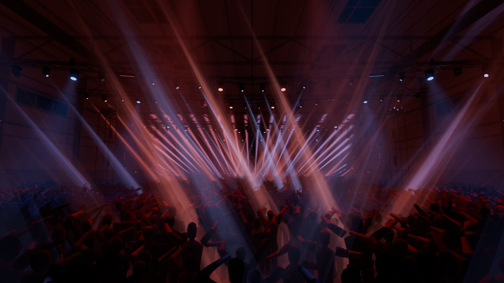
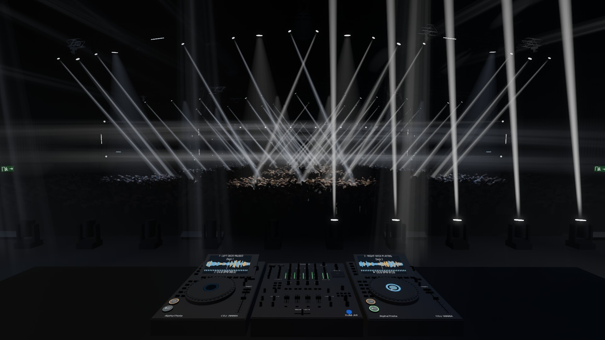
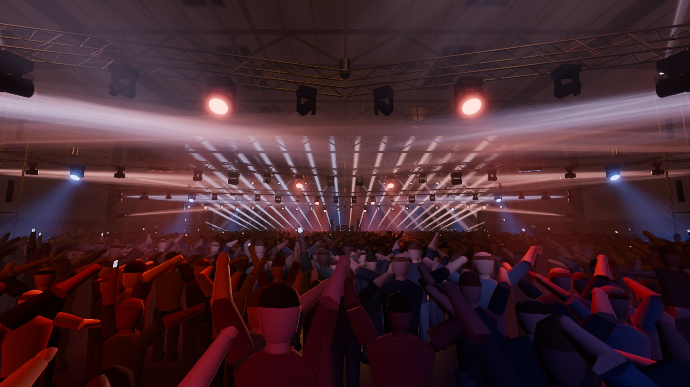
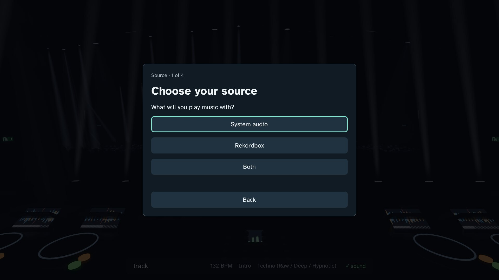
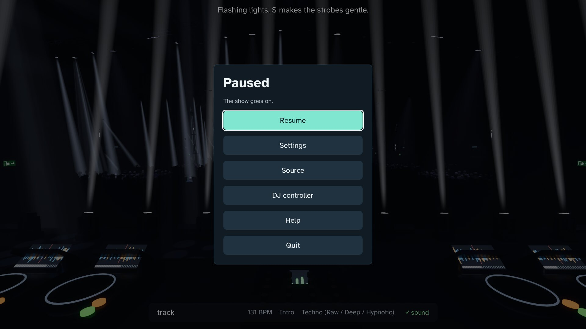

# Stage Visualizer

<p align="center">
  <picture>
    <source media="(prefers-color-scheme: dark)" srcset="docs/logo-dark.svg">
    
  </picture>
</p>

<p align="center">
  <strong>Stand behind the decks of a hangar show. The light follows what you play.</strong><br>
  A full-width festival stage in an industrial hangar, 182 moving heads, haze and a crowd of 3,000, lit live from your music.
</p>

<p align="center">
  <a href="#start">Get started</a> ·
  <a href="#music">Connect music</a> ·
  <a href="#keys">Keys</a> ·
  <a href="LICENSE">MIT license</a>
</p>



SV is for someone who DJs at home and wants the real thing around them: one hall, one stage over the full width, one
DJ booth with two CDJ-3000X players and a DJM-A9, flightcase edging and routed cables. Play from rekordbox or any
music on your computer, and a lighting designer runs the show: a mood for every genre, one palette per track,
looks held for a phrase, a build-up that
lowers the trusses, and a drop that opens the whole rig.

From 0.50 SV is built with **Godot 4.7** and runs on Windows, macOS and Linux. The browser version lives on in the
history of this repository, up to [v0.40.1](https://github.com/SlipstreamSurfer/stage-visualizer/tree/v0.40.1).

<table>
  <tr>
    <td width="50%"></td>
    <td width="50%"></td>
  </tr>
  <tr>
    <td align="center"><strong>Through the DJ's eyes</strong><br>The decks show what rekordbox plays.</td>
    <td align="center"><strong>The drop</strong><br>The whole rig opens; blinders light the crowd.</td>
  </tr>
  <tr>
    <td width="50%"></td>
    <td width="50%"></td>
  </tr>
  <tr>
    <td align="center"><strong>First start</strong><br>Choose your source and see that it works.</td>
    <td align="center"><strong>Escape</strong><br>A menu; the show goes on.</td>
  </tr>
</table>

*Actual screenshots of 0.53 at Ultra.*

## Start

1. Install [Godot 4.7.2](https://godotengine.org/download/) (standard version).
2. Clone this repository and start it:

```sh
./start.sh
```

or open the folder in Godot and press Play. The first time, SV asks for your music source, checks that it works,
sets the delay with a few taps and asks about flashing light. After that it opens on the start screen.

To make an app for Windows, macOS or Linux, see [builds](docs/builds.md).

## Music

- **System audio**: whatever plays on your computer. On macOS route it through BlackHole, see [macOS](docs/mac.md).
- **rekordbox**: through [rkbx_link](https://github.com/grufkork/rkbx_link), OSC on port 4460. SV then knows the
  beats, the phrases and the decks, sees a drop coming and lands it on the first beat of the Chorus. rekordbox can
  run on this computer or another one on your network: see [rekordbox](docs/rekordbox.md).
- **Both**: rekordbox for the timing, the sound for the energy.

## Keys

| Key | What |
|---|---|
| Esc | Pause menu (the show goes on) |
| ? or F1 | All keys |
| B | Blackout on / off |
| D | Light desk: group switches, percentage faders and haze (0–200%) |
| W | Washes on / off |
| Space | Strobe while held |
| N | Blinders while held |
| L | Next look |
| G | Next genre (Shift: back) |
| 1–5 | Camera: the DJ's eyes, over the shoulder, in the crowd, front of house, stage side |
| T | The one is here (tap on the first beat) |
| [ ] | Lights earlier / later |
| S | Gentle strobes |
| I | Info screen |
| H | Hide everything |
| P | Settings |

A DJ controller can work the same buttons: Pause menu → DJ controller → Learn, then press a pad.

## Inside

- **Hall**: an industrial hangar of 44 × 76 m, 15 m high: steel girders and columns, cladding, exits, haze, a
  concrete floor that shines when wet, and a crowd of 3,000 that moves to the music.
- **Rig**: five hall trusses in a V on chain hoists, a truss at the back, towers behind the DJ, delay towers and
  side towers: beams, spots with gobos, washes, strobe battens and blinders.
- **Show**: SV's lighting director, with 36 genres from Beatport, 25 looks for the heads, 15 truss formations and
  9 looks for the stage row ([how it works](docs/choreografie.md)).
- **Graphics**: Low to Ultra, or Auto, measured on your own computer.

## Record and replay

```sh
./start.sh -- --record
./start.sh -- --replay=local/sessions/NAME.jsonl
```

A session keeps the music's values for every frame and, when it can, a WAV copy. See [sessions](docs/sessions.md)
and [automatic checks](docs/show-checks.md).

## License

[MIT](LICENSE). Atkinson Hyperlegible is under the [SIL Open Font License](fonts/OFL.txt).
