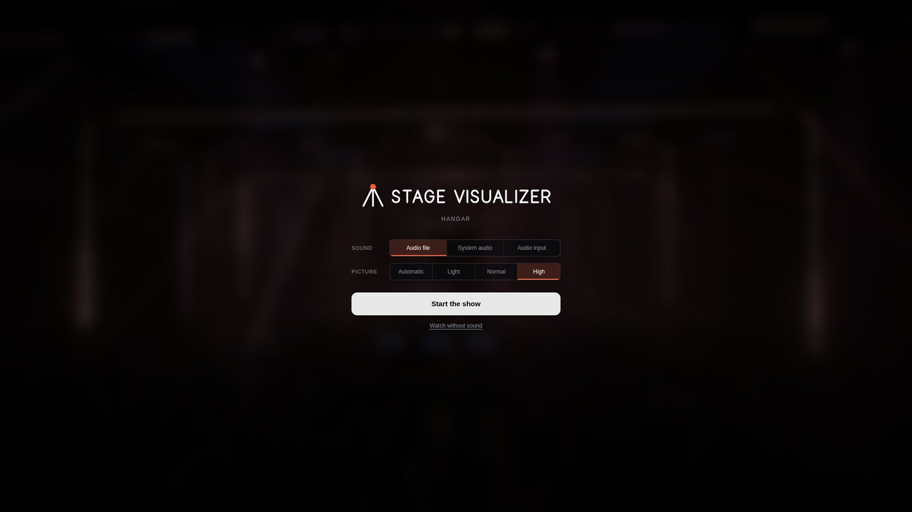
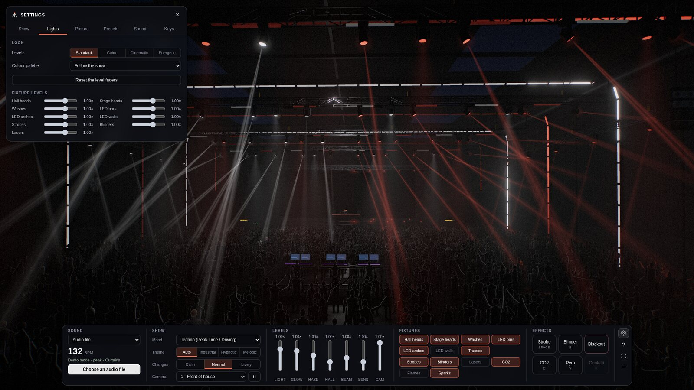

# Stage Visualizer

<p align="center">
  <picture>
    <source media="(prefers-color-scheme: dark)" srcset="docs/logo-dark.svg">
    
  </picture>
</p>

<p align="center">
  <strong>Turn your music into a live 3D light show.</strong><br>
  Moving lights, LED arches, cameras and a crowd — all inside your browser.
</p>

<p align="center">
  <a href="https://github.com/SlipstreamSurfer/stage-visualizer/releases/latest">Latest release</a> ·
  <a href="#start">Get started</a> ·
  <a href="#connect-music">Connect music</a> ·
  <a href="docs/macos-audio.md">macOS audio setup</a> ·
  <a href="LICENSE">MIT license</a>
</p>


<p align="center"><em>Hangar · the main stage of Stage Visualizer</em></p>

**Hangar** is the single public venue and the main stage for developing SV.
Choose from **48 moods** to shape the show, then adjust its look and camera.
WebGPU renders the show when available; WebGL provides a fallback.

| Music | Light show | Your controls |
| --- | --- | --- |
| Local tracks, audio inputs and supported system-audio sharing | Moving heads, LED arches, haze and a dancing crowd | Nine camera views, level faders and a switch for every light group |
| Audio processed locally in your browser | Automatic scenes shaped by the incoming music | Fine tuning, saved presets and keyboard effects |

<table>
  <tr>
    <td width="50%"><a href="docs/screenshots/hangar-dj-booth.jpg"></a></td>
    <td width="50%"><a href="docs/screenshots/hangar-controls.jpg"></a></td>
  </tr>
  <tr>
    <td align="center"><strong>From the DJ booth</strong><br>Decks, crowd and the lighting rig.</td>
    <td align="center"><strong>One console</strong><br>Every control for the show, always in the same place.</td>
  </tr>
  <tr>
    <td width="50%"><a href="docs/screenshots/hangar-start.jpg"></a></td>
    <td width="50%"><a href="docs/screenshots/hangar-settings.jpg"></a></td>
  </tr>
  <tr>
    <td align="center"><strong>Start the show</strong><br>Pick your sound and picture while the venue builds.</td>
    <td align="center"><strong>Settings apart</strong><br>What you set once, in six short pages.</td>
  </tr>
</table>

*Actual screenshots of the public 0.26.2 Hangar demo, using the Cool palette
and Energetic look. Click the smaller images to view them at full size.*

## Start

Install **Node.js 24 LTS or newer** and use a current Chrome or Edge browser.
No build step or npm dependencies are needed; three.js is included.

```sh
git clone https://github.com/SlipstreamSurfer/stage-visualizer.git
cd stage-visualizer
npm start
```

Open <http://127.0.0.1:8765/>. The show starts with a silent demonstration.
On macOS you can also double-click `Start-SV-Mac.command` after installing Node.js.

## Connect music

One choice says how you play, under **Sound** in the controls and on the start screen:

- **System audio:** whatever the computer plays (Spotify, a browser, any player).
- **Rekordbox:** you play yourself. The sound comes in through a virtual cable or an audio interface; track, tempo
  and phrase data from [rkbx_link](https://github.com/grufkork/rkbx_link) arrive on UDP 4460, which the server
  receives by itself.
- **Audio file:** select or drag in a local track, with pause, seek and restart, and optional Good/Wrong marks.
- **Other input:** a microphone, audio interface or any virtual input.

**Settings → Sound** shows the steps for the chosen way on this computer, macOS, Windows or Linux, in the names those
systems use (BlackHole 2ch and a Multi-Output Device on a Mac, VB-Cable or screen sharing with system audio on
Windows, the PipeWire input on Linux), and ticks off what SV can see: the device found, sound coming in, rekordbox
data arriving. The connect button takes the right device by itself. See also the
[macOS audio setup guide](docs/macos-audio.md).

## Control the show

The page opens on a start screen: choose the sound source and the picture quality while the venue builds behind
it, then **Start the show**. That click connects the sound, so the browser does not ask for another one. A reload in
the same tab goes straight back to the show.

During the show one console along the bottom holds everything you use live, always in the same place and without
scrolling: **Sound** (source, tempo, connect), **Track** (while a file plays), **Show** (mood, theme, pace of changes,
camera and freeze), **Levels** (faders for light, glow, haze, hall light, beam width, sound sensitivity and camera
speed), **Fixtures** (a switch for every light group and effect) and **Effects** (strobe, blinder, blackout, CO2,
pyro, confetti). **Settings** (the gear, or **S**) holds what you set once: choreography, hall heads and truss
formation, look presets, colour palette and a level per light group, graphics and extra smoke, screen content,
presets, the audio input device and the keyboard shortcuts. Venue changes preserve the active audio stream. A newer
tab with the show pauses the older ones.

**Graphics** (Settings → Picture) work as in a game: **Light**, **Normal**, **High** and **Ultra**, and under them every
setting on its own: resolution, sharpness on high-resolution screens, frame rate (30, 60 or the screen's), how many
people are drawn and how finely, how many beams light the surfaces, glints, reflections, glow, haze clouds and the
lights mirrored in the hall's sealed concrete floor. Every
setting changes the picture at once. **Automatic** measures your computer the first time: from Light up, a preset at
a time, as long as the picture keeps your screen's pace, and it keeps the best one (**Measure this computer again**
after a new graphics card). When frames take too long the picture first draws fewer pixels and sharpens again when
there is room; automatic steps down a preset only after that.

Look presets include Standard, Calm, Cinematic and Energetic; moving a fader makes a custom look.

**Time of day** (Settings → Show) puts the show at night, by day or at sunset; the **skylights** are covered unless
you open them, and then sunlight falls through them into the haze; the **hangar door** can open onto the airfield
outside, by day and by night. **Stage heads** sets up the stage's own moving heads: one long row of 24 (or 36) along
the front of the deck, played as one instrument (a curtain, fans, a V over the booth, waves, sweeps, chases and a
sunburst on the drop), or the three rows of before. **Show theme** combines wall images, light colours and arch/laser patterns:
Industrial, Hypnotic or Melodic; the wall develops within the theme through quiet passages, builds and peaks.
**Light choreography → Composed show** adds stage openings, slow hall waves and held light pictures, and the
automatic camera shows each composition. The hall heads have 25 looks and change them within a track and for every new track, the hall trusses hold one of
15 formations for minutes, in every mood; **Hall heads**, **Truss formation** and **Changes** pin them or set the pace. Select **Original show** to use the previous light patterns. See [Hangar themes and choreography](docs/hangar-themes.md).
Browser presets save your preferred settings. **Restore a balanced starting point** resets the show.

Hold **Space** for strobe and **B** for blinders. **K** triggers confetti,
**C** CO2 and **V** pyro where enabled. **H** hides the console, **S** opens the settings and **Esc** closes them; **F** toggles
fullscreen; **1–9** select cameras and **0** selects automatic cameras.
**W** lets you walk round yourself: W A S D to walk, the mouse to look (click the picture first), **E** and **Q** up
and down, Shift to go faster, **L** for the work lights, **Esc** to stop; the walking panel copies a link to the spot
you stand on. Settings → Picture can switch the people in the hall off for a lighter picture.
Effects unavailable in a venue are marked. Releasing a hold or leaving the
window releases held effects.

Optional file-playback feedback is saved locally under `rec/feedback/` by the
local server. Music is processed locally; feedback and presets are not uploaded
to a remote service. Keep local music and feedback out of source control.

## Optional OSC diagnostics

`npm run rekordbox` enables a local OSC receiver on UDP 4460, with a diagnostic
page at <http://127.0.0.1:8765/rekordbox.html>. A compatible external sender is
required. This product does not install or modify DJ software. The diagnostics
display track and timing data; the public show follows its audio input.
See [OSC diagnostics](docs/rekordbox-connection.md).

## Development

```sh
npm test
npm run listen -- track.mp3
npm run check -- track.mp3
```

`npm test` runs the fast Hangar and audio-engine checks. Use `npm run test:browser`
for one real Hangar render, generated audio, camera controls and quality changes.
`npm run test:audio` adds the longer listening and mix regressions.
`npm run test:extended` runs the longer regression checks when audio, rendering
or playback changes warrant them. Every browser check uses Hangar.

Browser checks require Chrome, Edge or Chromium; `BROWSER_PATH` selects an
executable. The Hangar WebGL check uses the native GPU on macOS, and on Linux
when a GPU is available; set `SV_TEST_SOFTWARE=1` to explicitly use the much slower
software renderer. Other platforms use the software renderer by default. Tests use generated audio and synthetic fixtures. Audio-analysis
commands need ffmpeg. See [CONTRIBUTING.md](CONTRIBUTING.md).

## License

[MIT](LICENSE). Bundled three.js is also MIT-licensed; see
[vendor/three/LICENSE](vendor/three/LICENSE).
