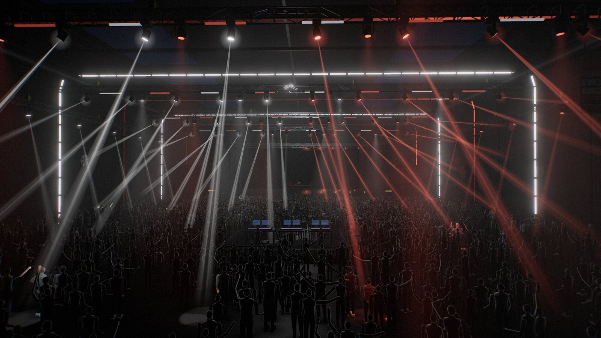
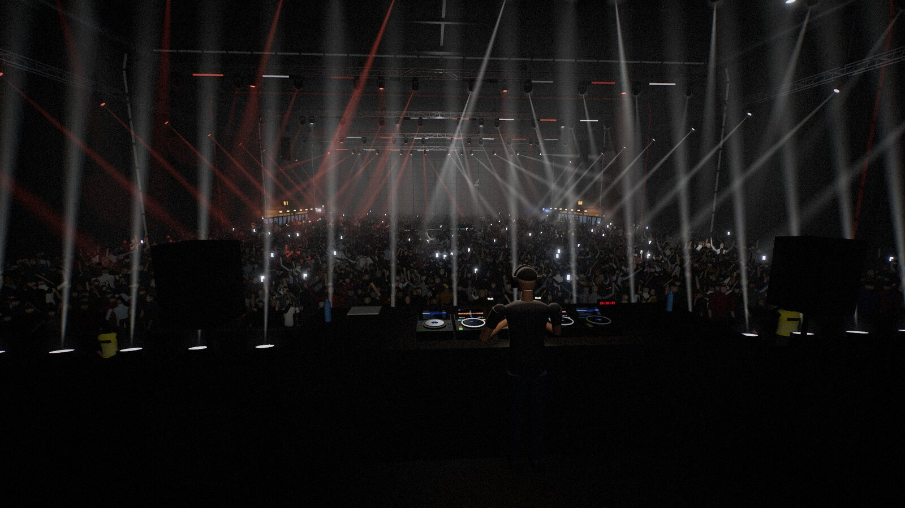
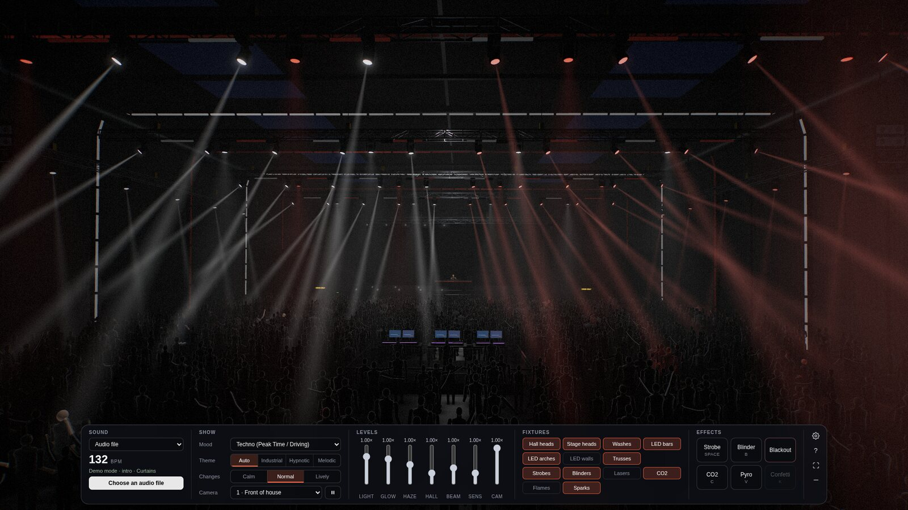

# Stage Visualizer

<p align="center">
  <picture>
    <source media="(prefers-color-scheme: dark)" srcset="docs/logo-dark.svg">
    
  </picture>
</p>

<p align="center">
  <strong>Turn your music into a live 3D light show.</strong><br>
  Moving lights, LED arches, cameras and a crowd — all inside your browser.
</p>

<p align="center">
  <a href="https://github.com/SlipstreamSurfer/stage-visualizer/releases/latest">Latest release</a> ·
  <a href="#start">Get started</a> ·
  <a href="#connect-music">Connect music</a> ·
  <a href="docs/macos-audio.md">macOS audio setup</a> ·
  <a href="LICENSE">MIT license</a>
</p>



<p align="center"><em>Hangar · the main stage of Stage Visualizer</em></p>

**Hangar** is the single public venue and the main stage for developing SV.
Choose from **48 moods** to shape the show, then adjust its look and camera.
WebGPU renders the show when available; WebGL provides a fallback.

| Music | Light show | Your controls |
| --- | --- | --- |
| Local tracks, audio inputs and supported system-audio sharing | Moving heads, LED arches, haze and a dancing crowd | Nine camera views, look presets and quick light switches |
| Audio processed locally in your browser | Automatic scenes shaped by the incoming music | Fine tuning, saved presets and keyboard effects |

<table>
  <tr>
    <td width="50%"><a href="docs/screenshots/hangar-dj-booth.jpg"></a></td>
    <td width="50%"><a href="docs/screenshots/hangar-controls.jpg"></a></td>
  </tr>
  <tr>
    <td align="center"><strong>From the DJ booth</strong><br>Decks, crowd and the lighting rig.</td>
    <td align="center"><strong>Shape your show</strong><br>Choose a mood, camera and look.</td>
  </tr>
</table>

*Actual screenshots of the public 0.26.2 Hangar demo, using the Cool palette
and Energetic look. Click the smaller images to view them at full size.*

## Start

Install **Node.js 24 LTS or newer** and use a current Chrome or Edge browser.
No build step or npm dependencies are needed; three.js is included.

```sh
git clone https://github.com/SlipstreamSurfer/stage-visualizer.git
cd stage-visualizer
npm start
```

Open <http://127.0.0.1:8765/>. The show starts with a silent demonstration.
On macOS you can also double-click `Start-SV-Mac.command` after installing Node.js.

## Connect music

Choose a **Sound source** and use its connection button:

- **Audio file:** select or drag in a local track. Playback includes pause, seek
  and restart, with optional Good/Wrong marks and CSV export.
- **Audio input:** connect a microphone, audio interface or virtual input.
  Select an input and click **Connect audio input**. Allow the expected browser
  microphone permission; device names appear after permission is granted.
- **System audio:** use the browser's supported system-audio sharing option.
  On Linux, a PipeWire input can carry system sound; see [Linux audio](linux/stage-visualizer.conf).

On macOS, an audio interface with loopback or a virtual audio device can carry
sound from a music player, streaming app or DJ software into SV. See the
[macOS audio setup guide](docs/macos-audio.md). Reconnect the audio input after
closing or reloading the page. A connected input with no detected audio is silent.

## Control the show

Venue, mood, look and camera are the main controls. Show, Lights, Effects and
Settings tabs contain finer controls. Venue and quality changes preserve the
active audio stream. Automatic quality reduces detail after sustained slow
rendering; explicit Light, Normal and High choices are remembered.

Look presets include Standard, Calm, Cinematic and Energetic. Adjust light,
glow, haze and hall sliders for a custom look. Light groups, palettes, beam
width and camera speed have their own controls. **Show theme** combines wall images, light colours and arch/laser patterns:
Industrial, Hypnotic or Melodic. **Light choreography → Composed show** adds
stage openings, slow hall waves and held light pictures. Select **Original
show** to use the previous light patterns. See [Hangar themes and choreography](docs/hangar-themes.md).
Browser presets save your preferred settings. **Restore a balanced starting point** resets the show.

Hold **Space** for strobe and **B** for blinders. **K** triggers confetti,
**C** CO2 and **V** pyro where enabled. **H** hides the panel; **F** toggles
fullscreen; **1–9** select cameras and **0** selects automatic cameras.
Effects unavailable in a venue are marked. Releasing a hold or leaving the
window releases held effects.

Optional file-playback feedback is saved locally under `rec/feedback/` by the
local server. Music is processed locally; feedback and presets are not uploaded
to a remote service. Keep local music and feedback out of source control.

## Optional OSC diagnostics

`npm run rekordbox` enables a local OSC receiver on UDP 4460, with a diagnostic
page at <http://127.0.0.1:8765/rekordbox.html>. A compatible external sender is
required. This product does not install or modify DJ software. The diagnostics
display track and timing data; the public show follows its audio input.
See [OSC diagnostics](docs/rekordbox-connection.md).

## Development

```sh
npm test
npm run listen -- track.mp3
npm run check -- track.mp3
```

`npm test` runs the fast Hangar and audio-engine checks. Use `npm run test:browser`
for one real Hangar render, generated audio, camera controls and quality changes.
`npm run test:audio` adds the longer listening and mix regressions.
`npm run test:extended` runs the longer regression checks when audio, rendering
or playback changes warrant them. Every browser check uses Hangar.

Browser checks require Chrome, Edge or Chromium; `BROWSER_PATH` selects an
executable. On macOS the Hangar WebGL check uses the native GPU; set
`SV_TEST_SOFTWARE=1` to explicitly use the software renderer. Other platforms
use the software renderer by default. Tests use generated audio and synthetic fixtures. Audio-analysis
commands need ffmpeg. See [CONTRIBUTING.md](CONTRIBUTING.md).

## License

[MIT](LICENSE). Bundled three.js is also MIT-licensed; see
[vendor/three/LICENSE](vendor/three/LICENSE).
