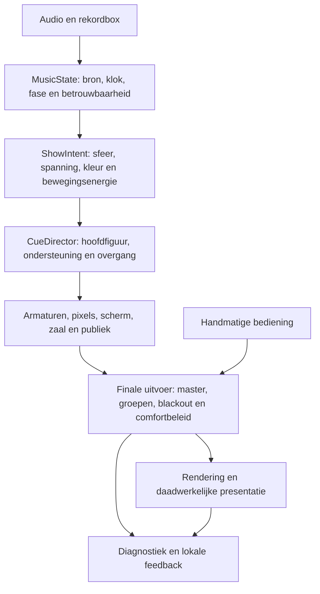

# SV: voorgesteld herstel- en ontwikkelplan

Status: uitvoering gestart na expliciete opdracht. De wijzigingen worden als lokale kandidaten in afzonderlijke stappen opgeleverd; er wordt niets publiek gepubliceerd zonder aparte goedkeuring. Lees daarnaast `choreography-blueprint.md` en `pattern-design.md`.

## Richting

Behoud Godot, de bestaande zaal en booth, de bruikbare rig, audio-ingang, rekordbox-koppeling, bediening en efficiënte rendering. Herontwerp vooral de regie, meetbaarheid en onderlinge afspraken. Een volledige herschrijving van alle assets is niet gerechtvaardigd.

Het doel is een langere, leesbare en samenhangende show waarin muzikale beweging en ruimtelijke figuren de basis zijn. Speciale patronen hebben een functie, plaats, duur en overgang. Rust moet voortkomen uit het ontwerp, niet uit achteraf steeds meer groepen uitzetten.

Het tijdsaandeel van benoemde effecten is onvoldoende als balanscriterium: ook een basisfiguur kan door gates, kickmodulatie, balken en bewegend tegenlicht voortdurend flitsend ogen. Geslaagde softwaretests zijn een voorwaarde, geen artistieke goedkeuring.

## Eén beoogde regieketen

`MusicState` is één afgesproken toestand met expliciete bron en betrouwbaarheid. `ShowIntent` is de muzikale bedoeling, niet een extra effect. `CueDirector` verdeelt rollen en beslist wanneer iets wordt aangehouden, ontwikkeld of vervangen. Een cue levert één complete, inspecteerbare uitvoerbeschrijving. Een incidenteel effect krijgt een afgebakende rol en mag niet ongemerkt de hele rig overnemen.

De finale uitvoer behandelt alle relevante kanalen: heads, washes, balkdimmers, pixelstappen, strobe, blinders en schermintensiteit. Comfortbeleid moet ook helderheidswisselingen buiten de expliciete strobe omvatten. Het is geen medische veiligheidsclaim.

## Fase 0 — Vastleggen en wijzigingen begrenzen

- Leg publieke baseline en lokale kandidaat afzonderlijk vast met bron-snapshot, artifact-hash, instellingen en release-notities.
- Bewaar sterke voorbeelden als referentie; behandel feedback op een fragment niet als waardering van ieder onderdeel daarin.
- Maak terugzetten van een lokale kandidaat voorspelbaar. Een nieuwe kandidaat overschrijft geen oude binary.
- Geen nieuwe algemene effecten stapelen terwijl de basisregie wordt onderzocht.

Gereed als: bij iedere rating aantoonbaar is welke onveranderlijke build en instellingen zijn gebruikt en de oude kandidaat terug te starten is.

## Fase 1 — Bronkeuze, comfortbediening en observatie

- Maak zichtbaar wat gekozen is, wat werkelijk actief is, of er een fallback is en waarom. Een launcher mag een opgeslagen bron niet verborgen overschrijven.
- Scheid expliciete strobe, harde dimmerstappen, percussieve helderheidsmodulatie en bewegingsintensiteit in de interne regels. Toon gewone, begrijpelijke keuzes in de UI.
- Definieer een rustige toestand voor alle groepen en het scherm. De aanwezigheid van nul op de strobe-uitgang alleen is geen bewijs van rust.
- Breid lokale feedback uit met sessie-ID, unieke build-identiteit, actieve versus vorige cue, werkelijke bronstatus, beat-/fasebetrouwbaarheid, audiofeatures en timing, effectieve faders en finale uitvoer per soort licht.
- Neem FPS, frame-timeverdeling, render scale, kwaliteitsprofiel, camera en relevante scherm-/haze-instellingen mee. Bewaar ruwe audio of video alleen bij een aparte expliciete keuze.
- Scheid korte diagnostische feedback van een optionele exacte replay. Geef aan wanneer de geschiedenis nog te kort is.
- Onderzoek de bestaande runtime-signaalmeldingen met een reproduceerbaar minimumvoorbeeld.

Gereed als: een onprettig fragment kan worden teruggevonden en verklaard zonder te raden naar bron, modus, camera, balkflitsen of framerate. Een expliciete rustige keuze voorkomt automatische harde flitskanalen in de gehele uitvoerketen.

## Fase 2 — Geometrie en lichtreferenties

### Back towers eerst correct indelen

De huidige eenzijdige verschuiving van de centrale toren moet verdwijnen. Het scherm vraagt om een centrale vrije zone; verschuif daarom niet één toren binnen een verder regelmatig raster.

Voorkeursvoorstel om te bekijken: acht torens op x = -21, -15, -9, -3, 3, 9, 15 en 21 meter. Dit geeft overal 6 meter tussenruimte en een symmetrische opening rond het middenscherm. Controleer de werkelijke breedte van bodies, yokes, truss, schermframe, zijwand en omliggende apparatuur. De getallen zijn een voorstel, geen reeds goedgekeurde plaatsing.

Alternatief met minder armaturen: zes symmetrische torens, met één gelijke steek en voldoende vrije schermruimte. Vergelijk de twee opstellingen in een rustig, statisch totaalbeeld. Kies eerst de geometrie; programmeer niet rond een scheef raster.

Acceptatie: gelijke opeenvolgende afstanden, spiegeling om x=0, geen zichtbare conflicten met het scherm, leesbare silhouetten vanuit booth en publiek en expliciete telling van armaturen.

### Licht kalibreren

- Maak referenties met één beam, één spot, één wash en één balk. Vergelijk daarna kleine groepen en de gehele rig.
- Stem direct licht, zichtbare bundel, halo, haze, glow, schermemissie en diffuse terugkaatsing op elkaar af.
- Controleer dat lokaal licht lokaal blijft en beoordeel occlusie, schaduwen en afstandsafname; benoem de resterende benaderingen.
- Beoordeel bij vaste referentiecamera's en meerdere kwaliteitsprofielen. Gebruik zowel neutrale faders als profielen met weinig washlicht en uitgeschakelde dominante groepen.
- Kalibreer balkhelderheid plaatselijk. Sterker zichtbare LED's mogen niet automatisch meer totale zaalflits of extra brede bloom betekenen.

Gereed als: de verhouding tussen soorten armaturen begrijpelijk en consistent is en de booth/achterrig zichtbaar blijft zonder compensatie door overal het licht te verhogen.

## Fase 3 — Basisregie en muziektoestand opschonen

- Breng de oude scène-/budgetstaat en de huidige director onder één aantoonbare beslisketen. Verwijder of isoleer ongebruikte selectiecode; laat niet twee begrippenstelsels verschillende diagnoses tonen.
- Maak alle klokken en eenheden expliciet: audio-sampletijd, seconden, beats, maten, cue-lifetime en render-delta.
- Geef classificatie van groove, break, build en peak vertrouwen, minimale vasthoudtijd en een duidelijke overgangsregel. Een kleine timbrale verandering hoeft geen volledige scèneherstart te veroorzaken.
- Laat het genre eerst karakter bepalen: schaal, bewegingssnelheid, ruimtelijke voorkeur en contrast. Het is geen opdracht om meer effecten tegelijk af te spelen.
- Behoud deterministische keuzes en herhalingsgeheugen, maar forceer niet bij iedere cue tegelijk een andere beweging, gate en kleur.
- Geef iedere property een eigenaar: positie, selectie, dimmer, kleur, beamvorm en pixelpatroon. Leg expliciet vast welke laag iets mag veranderen.

Gereed als: één actueel cue-object uitlegt waarom ieder zichtbaar deel van de rig speelt en er geen ongewenste stapeling is van basisgate, sequencer, compositiegolf en extra chase.

## Fase 4 — Roof spots en een sterke basis zonder dominante groepen

Bouw eerst een kleine set zorgvuldig gecomponeerde passages die ook zelfstandig werkt met Stage row en Hall beams uit. Dit is een diagnostisch profiel en een valide artistieke variant; de show mag niet instorten wanneer een groep uit staat.

De roof spots hebben nu een algemene podiumrol. Geef ze een eigen positie- en bewegingsvocabulaire met bijvoorbeeld langzame spiegelbewegingen, diagonale kruisingen, ingehouden gobofiguren en duidelijke hoge/lage accenten. Beoordeel de ruimtelijke resultaten; namen alleen zijn geen variatie.

Werk vervolgens combinaties uit:

- Roof spots dragen de figuur; bars tekenen rustige lokale accenten.
- Back towers dragen diepte; roof spots voegen een contrasterende beweging toe.
- Bars dragen een segmentpatroon; spots blijven aangehouden of bewegen langzaam.
- Een beperkte podiumrij ondersteunt kort en laat daarna weer zicht vrij.
- Hall beams komen pas terug wanneer hun toevoeging het bestaande beeld versterkt.

Gereed als: elke combinatie op zichzelf leesbaar is, de hoofdrol hoorbaar/muzikaal te volgen is en er over meerdere minuten zowel aanhouden, ontwikkeling als ontlading bestaat.

## Fase 5 — Bars als echt programmeerbaar instrument

### Eerst bestaande mogelijkheden verbeteren

De huidige shader tekent twaalf visuele segmenten per balk, maar de software geeft geen onafhankelijke dimmer-/kleurstaat per segment door. Er is vooral één kleur, één niveau en één bewegend venster. Dat is nog geen volwaardige pixelbar.

Voeg een logische segmentbuffer toe met per segment dimmer en, waar nodig, kleur. Houd de bestaande efficiënte batching; maak niet ieder LED-segment een afzonderlijke zware scene-node. Begin met de bestaande twaalf segmenten en vergelijk leesbaarheid voordat de resolutie wordt verhoogd.

Patroonfamilies om te ontwerpen: links/rechts 50/50, afwisselende segmenten, even/oneven, korte groepen, midden-uit, spiegelparen, voortbewegende accenten en tegengestelde lokale banen. Elk heeft ook een langzame of aangehouden uitvoering. Voorkom dat alle balken tegelijk hetzelfde harde patroon krijgen.

Scheid kleur-LED's en expliciete strobefunctie. Kalibreer zichtbare emissie, bloom en lokale lichtbijdrage afzonderlijk. Leg in diagnostiek zowel het bar-niveau als de pixelstaat en de finale uitvoer vast.

### Daarna pas extra armaturen

Huidige inventaris: 49 bars; 8 voor, 14 achter, 10 boven de hal, 5 achter in de zaal, 4 bij delay towers en 8 langs de zijkanten. Er zijn nu geen bars in de roof-groep boven het podium. Dat maakt een gecontroleerde toevoeging daar het eerste ontwerp om te vergelijken.

Voorstel A: 8–12 roof-bars, geplaatst tussen of op een aparte lijn naast de bestaande spots, met controle op bodies, truss en zichtlijnen. Voorstel B: daarna een aanvullende rij heads op de gekozen back-toweropstelling, één per toren. Onderzoek spots als aanvulling op de bestaande beams, zodat de uitbreiding een nieuwe rol krijgt in plaats van alleen meer van hetzelfde te leveren.

Geen definitieve aantallen vóór de keuze voor zes of acht symmetrische towers en een prestatiemeting. Beoordeel bestaande rig, alleen pixelverbetering en riguitbreiding apart.

Gereed als: segmenten werkelijk afzonderlijk programmeerbaar zijn, de balken sterker leesbaar zijn zonder het totaalbeeld te overbelichten, en de meerwaarde van extra hardware aantoonbaar is.

## Fase 6 — Incidentele patronen herintroduceren

Pas na een overtuigende basis komen lightning, Depth chase en andere bijzondere passages terug in de nieuwe regie.

- Behoud een goed bevonden ruimtelijk idee; maak scope, duur, muzikale trigger en overgang expliciet.
- Depth chase mag langer ontwikkelen wanneer hij speelt, maar bezet niet voortdurend de hele show.
- Lightning blijft een kleur- en richtingsgetrouw accent binnen de lopende scène.
- Een sequencer schakelt hele armaturen in een leesbare ruimtelijke volgorde. De overige rig blijft bewust gecomponeerd.
- Een opgegeven scope moet overeenkomen met de werkelijke beïnvloede groepen. De scope is geen decoratieve metadata.
- Light rain blijft verwijderd.
- Meet naast tijdsaandeel ook effectieve helderheidswisselingen, regionaal gelijktijdig schakelen en cumulatieve stapeling van effecten.

Gereed als: dezelfde muziek met en zonder de passage kan worden vergeleken, de overgang overtuigt en het bijzondere patroon de basis aanvult in plaats van verdringt.

## Fase 7 — Scherm, zaal, publiek en camera samenbrengen

Koppel schermhelderheid, visuele drukte, zaallicht en publieksreactie aan dezelfde `ShowIntent`. Laat ze niet als zelfstandige shows voortdurend aandacht vragen. Behoud bruikbare meshes, materialen en efficiënte crowd-batching.

Beoordeel scherm versus booth, haze versus zichtlijnen, beam versus camerastandpunt en publiek versus leesbaarheid. Controleer dezelfde passage vanuit booth, crowd en FOH. Houd gebruikerscontrole over de camera; voeg geen onverwachte camerawissels toe om een lichtprobleem te verbergen.

Lasers zijn momenteel uitgeschakeld. Het opnieuw activeren ervan is een aparte latere ontwerpbeslissing, geen onderdeel van de eerste herstelfase.

## Fase 8 — Bedienbaarheid, prestaties en robuustheid

- Maak bronkeuze en comforttoestand eenduidig en zichtbaar; toon fallback als fallback.
- Geef lichttafelprofielen een duidelijke betekenis, herstelmogelijkheid en bescherming tegen onbedoeld permanent alles op 100% zetten.
- Behoud heldere toetsen, focusgedrag, ontsnappen uit tekstinvoer en betrouwbare release van ingedrukte strobe-/blinderknoppen.
- Meet frame-timepercentielen en haperingen op representatieve passages; een gemiddelde of mediaan alleen is onvoldoende. Voeg de kosten van pixelbars en riguitbreiding afzonderlijk toe.
- Houd choreografie onafhankelijk van framerate; test gemiste renderframes, audiogaten, herverbindingen, tempowissels, stilte, seeks en bronwissels.
- Begrens het verwerken van netwerkberichten per frame en valideer ontwikkelinstellingen voordat ze uitvoer beïnvloeden.
- Onderzoek runtime-fouten zonder ongedocumenteerde aannames over hun oorzaak. Test Windows en macOS daadwerkelijk voordat er platformbrede gebruiksclaims volgen.

Gereed als: de bedoelde bron en bediening overeind blijven, de gekozen frametijd stabiel haalbaar is en de renderer een patroon niet door timingproblemen in iets anders verandert.

## Fase 9 — Beoordelen en lokaal releasen

Gebruik drie lagen bewijs:

1. Softwarecontracten: getallen, routing, grenzen, opslag, bediening en determinisme.
2. Presentatiecontroles: werkelijk gerenderd beeld, helderheidsverloop, zichtlijnen, overgangen en prestaties.
3. Artistieke beoordeling: langere passages, relevante muziek en lokale feedback met context.

Een nieuw effect krijgt niet meteen een algemene frequentieverhoging na een positieve markering. Een negatieve markering verwijdert niet automatisch alle figuren uit het venster. Maak onderscheid tussen vorm, overgang, kleur, duur, intensiteit en plaats in de show.

Lever per stap één onveranderlijke lokale kandidaat met een kleine, duidelijke wijziging. Vergelijk waar mogelijk dezelfde bron en instellingen met de vorige kandidaat. Behoud een terugweg. Publiceer pas na expliciete goedkeuring.

## Uitgevoerd in kandidaat 0.60.0-test1

- De launcheroptie voor het audioapparaat overschrijft niet langer de opgeslagen audiobron.
- De back towers staan op acht symmetrische posities met een gelijke tussenafstand van zes meter.
- De volledige Godot 4.7.2-checksuite slaagt voor deze kandidaat.
- De al aanwezige roof-spot-, sequencer-, depth-chase-, scherm- en feedbackwijzigingen zijn meegenomen in deze lokale kandidaat.

## Resterende uitvoering

Volgende stappen zijn pixelbars met onafhankelijke segmentwaarden, de visuele beoordeling van de towergeometrie, een roof-spotpassage die zonder Stage row en Hall beams leesbaar blijft, daarna pas nieuwe roof-bars en een extra spotrij op de back towers. Vervolgens volgen samenhang, comfortlogging, prestaties, scherm/zaal/camera, langere praktijkbeoordeling en lokale iteraties. De candidate status is geen artistieke goedkeuring.
